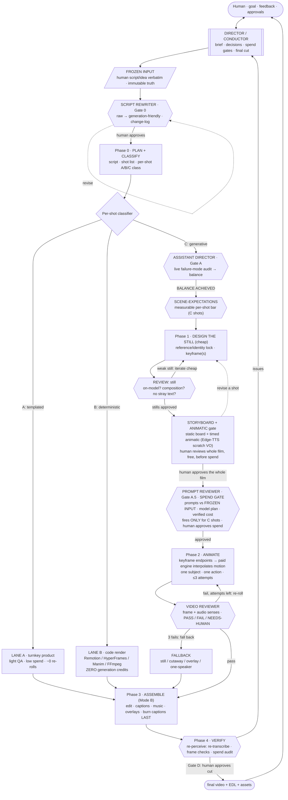
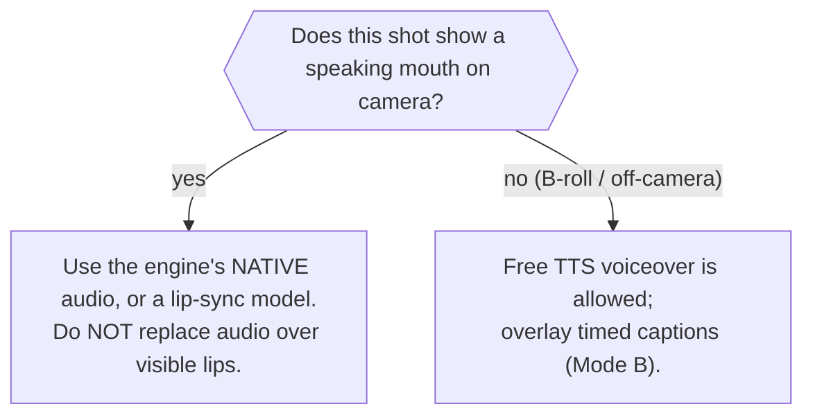

# AI Video Production Workflow (single source of truth)

The one document for turning **any script or idea into any finished AI video** in this repo: caricature ad, human UGC reel, satire politoon, narrated explainer, product demo, montage. It consolidates the abstract pipeline and the verified 2026 research (paid-engine categories, the agent-as-operator model, and the ComfyUI flow transfer) into one refactored system.

**Last refactor:** 2026-07-07. This doc defines the *system* (roles, gates, modes, the shot classifier, verification). It hard-codes no vendor: concrete tools live in [Current bindings](#appendix-b-current-bindings). A per-project instance under `ads/<name>/workflow.md` binds the pluggable slots to one job.

---

## 1. The four hard rules (non-negotiable)

Three independent research threads AND our own production experience converged on the same four rules. Convergence from independent sources is why these are gates, not suggestions:

1. **One subject, one action per shot.** Do not ask a model to stage multiple things at once.
2. **Still-first: never animate a weak still.** Image iteration is cheap; video iteration is expensive. If the frame is not excellent, the clip will not be.
3. **Three-attempt cap per generative shot, then fall back.** Most wasted spend is forcing a bad shot to work.
4. **Decompose multi-speaker into one-speaker-per-shot.** Two or more moving mouths in one frame fails (native multi-speaker lip-sync is unsolved). Group the rest as narrated.

---

## 2. Core operating principles

- **Human at the gates, machine between them.** A Director/Conductor owns intent, decisions, spend, and final cut. Specialist subagents do the parallel per-shot labor.
- **Freeze the source of truth.** The human's original script/idea is saved verbatim and never edited again. Every downstream check measures *drift from that frozen artifact*.
- **Three production modes, and you spend only where you must** (Section 3). Most work is cheap or free; paid generation is a minority of shots and always the last money spent.
- **Spend order, never out of order:** free thinking → cheap scripting → cheap still/image iteration → ONE paid video engine → manual/code edit → only THEN more generations. Never spend paid video credits to *discover* the idea.
- **Cheap before expensive.** Review stills before animating; pilot one or two shots before batching.
- **Verify by re-perceiving, never by asserting.** "Done" means re-observing the output (re-transcribe audio, re-extract frames), not claiming it worked.
- **Be honest about what stills cannot prove.** Motion, voice, and lip-sync get `NEEDS-HUMAN`, never a guessed PASS.
- **Compound every failure.** A defect that passes a gate becomes a new check in the rewriter's trigger list or the assistant-director's research notes.

---

## 3. The three production modes

The central refactor: not every video is AI-generated. Classify each shot into one of three modes, because the mode decides the cost, the reliability, and the pipeline.

| Mode | What it is | Predictability | Credit cost | Use for |
|---|---|---|---|---|
| **A. Turnkey templated** | A product owns the whole problem (avatar, TTS, lip-sync, layout) | High within the happy path | Low, per-output | single talking head, avatar spokesperson, dubbing, URL-to-UGC-ad, testimonial |
| **B. Programmatic / deterministic** | The agent writes code that RENDERS the video: Remotion (React), HyperFrames (HTML/CSS), Manim (diagram/math), FFmpeg (edit) | **Total** (renders exactly what you code) | **Zero generation cost** | text/hooks, UI/app demos, explainers, data viz, kinetic typography, captions, transitions, branding, long-to-short repurposing, all editing |
| **C. Generative AI video** | A paid model imagines motion/imagery from a prompt or still | **Low** (the drift/hallucination lane) | High, per-second | cinematic b-roll, mood/atmosphere, worlds, photoreal motion, novel looks, 3 to 5s inserts |

**Strategic insight:** Mode B is the default for anything precise and it is nearly free. Do not spend Mode C credits on text, UI, charts, or captions (a model does them worse, less repeatably, with baked-in-text risk). **Reserve Mode C for what only a model can imagine, and spend it last.**

---

## 4. The shot classifier and routing (per video kind)

At planning, every shot gets a mode. Route accordingly:

| Video kind / shot | Mode | Tool type | Spend posture |
|---|---|---|---|
| Single talking-head UGC ad | A | avatar/UGC-ad product | low, batch variants |
| Avatar spokesperson / presenter explainer | A | avatar product | low |
| Product-URL → many ad variants | A | URL-to-UGC-ad product | low, high-volume |
| Podcast / webinar / talk → vertical shorts | B (repurpose) | transcript + segment score + FFmpeg cut + code captions | near-zero (no generation) |
| Hook text / kinetic typography / lower-thirds | B | Remotion or HyperFrames | zero generation |
| UI / app demo / feature callouts / explainer | B | Remotion (+ screen capture) | zero generation |
| Data viz: charts, counters, timelines | B | Remotion or Manim | zero generation |
| Branded intro / logo motion / before-after | B | Remotion or HyperFrames | zero generation |
| Captions / subtitles on any clip | B | FFmpeg+libass or code render | zero generation |
| Raw clip cleanup: trim, merge, resize, compress, grade | B (edit) | agent + FFmpeg (test on a 10s sample first) | zero generation |
| Cinematic b-roll / mood / world / 3 to 5s inserts | C | one paid engine, image-first | paid; still-first; 3-attempt cap |
| Product reveal / semi-creative hero shot | C (image-first) | paid image-to-video from a locked still | paid; iterate the still, not the video |
| Two+ people speaking to each other in one scene | AVOID / hybrid | decompose to one-speaker-per-shot + voiceover + edit | minimize; use fallback |
| Talking character inside a custom world | Hybrid | avatar/talking insert over cinematic b-roll | mixed |
| Tutorial / screen recording | B (capture + edit) | screen record + agent FFmpeg/code captions | zero generation |

Most rows are Mode A or B (cheap, reliable). Mode C is a minority and always the last spend.

**"Template-safe" test:** a shot is Mode A if it fits a product's happy path (one subject, standard framing, no novel staging). If it needs custom blocking, interacting characters, or a look the product does not offer, it is Mode C and treated as unpredictable until proven.

---

## 5. The flow

---

## 6. Roles

The Director/Conductor plus six specialist subagents. The six are the fixed harness; they are style- and engine-independent. In this refactor the Director also acts as **code-tool conductor** for Mode B (drives Remotion/FFmpeg/render) and spend-gates Mode C.

| Role | Owns | Does NOT |
|---|---|---|
| **Director / Conductor** (main agent) | brief, per-shot A/B/C classification, prompt authorship, spend gates, Mode-B code orchestration, storyboard assembly, final assembly, verification, reporting | declare "done" on motion/voice/lip-sync it cannot perceive |
| **Script Rewriter** (`script-rewriter`) | Gate 0: rewrite the frozen raw script into a generation-friendly one, fixing every failure trigger with a change-log | write model prompts or generate video |
| **Assistant Director** (`assistant-director`) | pre-emptive risk audit of C shots vs the engine's live-researched failure modes; loops to `BALANCE ACHIEVED` | generate, spend, or edit the script (advises only) |
| **Scene-Expectations** (`scene-expectations`) | the measurable per-shot acceptance bar for C shots (severity, how-to-verify, frame-vs-human) | review, generate, or edit (defines the bar only) |
| **Prompt Reviewer** (`prompt-reviewer`) | Gate A.5 spend gate: check final prompts vs the frozen input for unsanctioned regressions; model plan + verified cost + AV review method; **fires only for C shots** | generate, spend, or edit the frozen input / approved rewrite |
| **Video Reviewer** (`video-reviewer`) | score stills and clips against the bar; PASS / FAIL / NEEDS-HUMAN with cited timestamps; adversarially hunt known artifacts | generate or edit |
| **Video Editor** (`video-editor`) | frame-accurate surgical post + Mode-B assembly; touch only what is broken, pass correct footage through byte-for-byte | any AI generation or credit spend |

---

## 7. Phases and gates (spend discipline)

| Gate | When | Applies to | Condition to pass |
|---|---|---|---|
| **Gate 0** | before planning | all | frozen input saved verbatim; `script-rewriter` output approved by human |
| **Classify** | Phase 0 | all | every shot assigned Mode A / B / C |
| **Gate A** | after Phase 0 | **C only** | assistant-director loop reaches `BALANCE ACHIEVED`; scene-expectations bar written |
| **Gate B (still)** | Phase 1 | **C only** | the still/keyframe is reviewed and approved BEFORE any paid video (fix cheap frames, not clips) |
| **Storyboard + animatic gate** | after Phase 1, before the spend gate | **C shots, whole film** | all locked keyframes assembled into a film-order board (VO + camera + mode/status) AND a timed animatic (keyframes cut to a free Edge-TTS scratch VO with Ken-Burns moves, muxed to mp4); the human reviews the WHOLE film flow, pacing, and timing, and approves before any paid generation. Last human checkpoint before money. |
| **Gate A.5 (SPEND GATE)** | before paid generation | **C only** | prompt-reviewer clean, model plan + verified cost + AV review method; human approves the spend. Modes A and B skip this. |
| **Gate C (pilot)** | early Phase 2 | **C only** | animate 1-2 shots; human judges motion/voice/lip-sync BEFORE batching |
| **3-attempt cap** | Phase 2 | **C only** | max ~3 attempts per shot, then fall back (still / cutaway / overlay / one-speaker) |
| **Gate D** | after Phase 4 | all | human approves the final cut; caption/music tweaks are cheap re-edits |

Modes A and B are fast lanes: light QA, minimal or zero spend, near-zero iteration. The heavy gated pipeline exists to protect Mode C spend.

**Ordering rule:** per-shot keyframe stills (Phase 1 / Gate B) are generated only AFTER the Gate 0 rewrite has decomposed and locked the shot list, so stills are built against the final shots, not draft ones. Shot-agnostic character/identity references (the bible) may be built earlier, since they do not depend on the shot cut.

**Storyboard gate (why it exists):** per-shot still review (Gate B) checks each keyframe in isolation; it does not show whether the film *reads* as a whole. So after every keyframe is locked, assemble them into a film-order storyboard (a deterministic Mode-B board: each shot's keyframe + its VO line + camera + mode/status), and get human sign-off on the entire sequence. It is cheap (assembling stills, zero generation) and it is the last chance to catch a flow, pacing, or continuity problem while fixes are still free, before the spend gate turns keyframes into paid clips. Shareable, so external stakeholders can approve here too. **Deliver it in two forms:** a static board (keyframe + VO + camera + status per shot) for a quick scan, and a timed **animatic** (the keyframes cut to a free scratch VO via Edge TTS, with Ken-Burns moves and an optional music placeholder, muxed to an mp4) so pacing and timing are visible before a single paid clip. Both are Mode B and local (ffmpeg + Edge TTS): zero cost. The scratch VO is a placeholder; the final voice is still the real TTS/recording at assembly. **Timing is frame-locked (audio-master):** every picture is held for exactly its narration length plus explicit pauses, quantized to whole frames, so narration and picture cannot drift, for any script, and the build verifies to zero drift. The same system builds the final cut. Method + reusable tool: `AV_SYNC_SYSTEM.md` (`tools/av_sync_render.py`), packaged as the **`storyboard-animatic` skill**; the `video-editor` builds it, the `video-reviewer` checks narration/picture sync. Branded cards, captions, and overlays (end card, lower-thirds, the राम/stripe text) are rendered Mode-B with **HyperFrames** (locally via Brave, zero credits) and slot into the frame-locked timeline as `video` shots, fit to each shot's frame count.

---

## 8. The staged method for Mode C (from the ComfyUI flow)

The community's impressive results come from a **staged flow, not one-shot generation.** Adopt the staging, which transfers even though the node graphs do not:

1. **Design the look cheap (low-res / cheap image).** Iterate the composition and identity HERE, before spending on video.
2. **Lock identity and structure upstream (feeder stages).** Reference/subject images anchor identity; a control signal (pose/depth) anchors structure where the engine accepts it.
3. **Keyframe the endpoints.** This is the strongest paid transfer: give the engine a locked first (and, where supported, last) frame and prompt only the *motion*.
4. **Let the paid engine interpolate the motion.** One subject, one action.
5. **Refine (upscale / detail / interpolate).**

**Transfer reality (verified, do not overstate):**
- **Keyframe endpoints transfer strongly** (Runway keyframes; Kling start/end, available via Higgsfield; Veo/Sora first-frame image-to-video).
- **Keyframing does NOT fix identity drift.** It controls composition and motion direction only; the end frame is a target the clip resolves toward, not a hard deterministic endpoint.
- **Raw control maps (pose/depth/canny video) mostly do NOT transfer** to paid video engines (they accept reference/keyframe *images*, not control *maps*). Latent denoise and per-tile redraw are hidden on paid video engines.
- So the "local-as-feeder" pattern is worth running **for control/keyframe frames, not for control maps.**

---

## 9. Decision nodes

**Audio strategy per shot** (the single most important generation constraint):

**Model choice for Mode C** (mid-2026 snapshot, re-check before reuse): prefer Seedance 2.0 or Kling 3.0 for visual quality; Veo only when its native-audio lip-sync is the deciding factor (it trails on the arena); **avoid Sora** (sunset as a standalone product from March 2026). The Kling/Veo/Seedance quality band is within benchmark noise, so decide by feature fit (keyframe control, native audio, duration), not leaderboard rank.

---

## 10. Verification doctrine

- **Re-perceive the output.** Re-transcribe the assembled audio and confirm spoken lines appear in script order; re-extract frames and re-check failed criteria.
- **AV senses for review.** Judge frames with frame/video analysis, speech with speech-to-text, voice quality with an objective metric where available. Frames alone cannot pass motion, voice, or lip-sync.
- **NEEDS-HUMAN is expected**, not a failure of the reviewer. Escalate what stills cannot prove.
- **Spend audit every run.** Reconcile credits/quota spent against the approved plan; overspend from tooling bugs becomes a guardrail in the driving skill.
- **Frame-locked assembly.** The timeline is audio-master and frame-quantized: each shot's on-screen frames are derived from its measured narration plus explicit pauses, so narration and picture verify to zero drift for any script (`AV_SYNC_SYSTEM.md`). No assembly is "done" until it reports SYNC LOCKED. And **a line owns its visuals:** the picture illustrating a line is on screen WHILE that line plays (a line needing several pictures cuts them within its span), never a trailing silent beat after the line ended.

---

## 11. Pluggable slots (bound per project)

| Slot | Bound at | Filled with |
|---|---|---|
| Style / format | Phase 0 | caricature ad, human UGC, politoon, explainer, montage |
| Skill lane | Phase 0 | the production skill driving the chosen mode |
| Still model (Phase 1) | prompt-review | cheapest image engine at acceptable quality |
| Motion model (Phase 2) | prompt-review | video engine fitting the shot (keyframe control, native audio, duration) |
| Audio source (Phase 2) | per shot | native engine audio, lip-sync model, or TTS (per the audio decision node) |
| Caption style (Phase 3) | Phase 3 | language, script, karaoke vs static, placement (or none) |
| Reference assets (Phase 1) | prompt-review | how many identity/style refs, or none |
| Acceptance bar | Gate A | the scene-expectations criteria for this job |

---

## Appendix A: Evidence (condensed research, verified 2026-07-07)

*Two deep-research runs (paid categories + ComfyUI flow) and a fact-check of the operator model. Findings adversarially verified; refuted hype is listed so it is not repeated. Time-sensitive: video models change monthly, re-check before reuse.*

**Category A (templated) is genuinely reliable.** HeyGen leads all-round + multilingual (Hindi supported). Qualification: it translates to *pure Hindi, not code-mixed Hinglish*, and lip-sync degrades on fast speech, so for Hinglish our native-audio path may still win (untested, an open question). Discount vendor "best generator" rankings (e.g. Hedra self-ranks #1 with no third-party validation).

**Category B (creative) is bottlenecked by structural character/identity drift.** Every foundation model generates each clip with no memory of the last, so faces drift more with motion, expression change, and shot-chaining. **Higgsfield inherits this because it is a broker over Seedance/Veo/Kling/Wan.** Any "consistent characters across scenes" marketing is refuted. Benchmark reality: Seedance 2.0 leads the with-audio arena; Kling 3.0 and Veo 3.1 sit ~110-130 Elo behind, within noise. **Sora sunset from March 2026.** The arena measures short-clip aesthetics, NOT multi-character dialogue reliability.

**De-risking (verified).** Image-first beats raw text-to-video. First-last-frame control and reference conditioning reduce (not eliminate) drift. Reference image alone is insufficient for identity; a trained LoRA is the strongest anchor but is LOCAL-only (hosted lane substitutes Soul ID / Kling Elements, a lower consistency ceiling).

**The agent-as-operator model (verified anchors).** Remotion officially supports coding agents including Claude Code (create-video → preview → render). The Comfy Cloud MCP runs real generation from an agent and is spend-gated ("blocks execution until your agent confirms you agreed to spend credits"). The agent is steerable via seven surfaces (CLAUDE.md, rules, skills, subagents, hooks, output styles, system prompt). **Correction to circulating claims:** HyperFrames is HeyGen's *open-source HTML/CSS-to-video render engine* (headless Chrome + FFmpeg, local, no per-render fee), NOT an overlay API; and the agent is a code-tool *conductor* that decides when to spend, not a pure non-generator.

**The ComfyUI flow (verified).** Core image techniques (hires-fix, tiled redraw, IPAdapter identity, ControlNet extraction) are reliable and reproducible (primary tool-author sources). Leading-edge video wrappers are capability-strong but quality-brittle (seam/coherence drift, identity drift through motion). The transferable part is the **staging** (Section 8), not the node graphs.

**Refuted hype (do NOT repeat as fact):** "Seedance has best-in-class cross-shot consistency"; "native audio is Veo/Sora/Kling only"; "Veo does 60s 4K with consistent identity"; "keyframes are deterministic exact endpoints"; "FLF anchoring fixes identity drift"; "workflow-in-PNG proves one-click reproducibility"; "the Kijai wrapper is author-warned unstable."

**Open questions to test ourselves (cheap experiments):**
1. Real multi-character dialogue reliability (two moving mouths in one frame) of Seedance vs Kling vs Veo, no benchmark isolates this.
2. Typical re-roll count and credit budget per hard shot (default cap is our decision: 3).
3. How much Soul ID / Kling Elements close the drift gap vs a local LoRA.
4. Can any tool produce ad-quality code-mixed Hinglish talking-head, or is native-audio caricature still better.
5. Do our paid engines accept TRUE control maps (pose/depth video), or only reference/keyframe images.

**Primary sources:** Artificial Analysis video arena (artificialanalysis.ai/video/leaderboard); Wan FLF2V ComfyUI doc (comfy.org); Runway keyframes (help.runwayml.com); Kling start/end (kling.ai, higgsfield.ai/blog/Kling-Start-End-Frames); HeyGen translate/pricing (heygen.com); OpenAI Sora discontinuation (help.openai.com, techcrunch.com 2026-03-29); Remotion + Claude Code (remotion.dev/docs/ai/claude-code); Comfy Cloud MCP (docs.comfy.org/agent-tools/cloud); ComfyUI examples + cubiq (github.com/comfyanonymous/ComfyUI_examples, github.com/cubiq); Kijai WanVideoWrapper (github.com/kijai/ComfyUI-WanVideoWrapper); HyperFrames (github.com/heygen-com/hyperframes). Full telemetry: `.../subagents/workflows/wf_8917e80f-a92` and `.../wf_68c2b5e6-0c9`.

---

## Appendix B: Current bindings

*One instantiation, not part of the abstract definition. Changes as tools change.*

- **The six agents:** `.claude/agents/` = `script-rewriter`, `assistant-director`, `scene-expectations`, `prompt-reviewer`, `video-reviewer`, `video-editor`.
- **Skill lanes:** `caricature-talking-ad` (3D-caricature ads), `audio-first-reel` (human UGC), `seedance-satire-director` (politoons), `comfyui-wan-local` (local lip-sync). Depth: `higgsfield-cinematic`, `multi-take-video-edit`, `video-captions-karaoke`, `cut-video`, `video-use`.
- **Mode A (turnkey):** HeyGen (avatar/dubbing), Arcads / Creatify (UGC ad variants), Higgsfield UGC/Marketing Studio.
- **Mode B (deterministic render):** Remotion (React video), HyperFrames (HTML/CSS to video), Manim (diagrams), FFmpeg (edit via the `mfa` conda env). Not all installed yet; Remotion + a HyperFrames/Manim skill would complete this lane.
- **Mode C (generative):** Higgsfield-brokered engines (Veo native-audio dialogue, Kling start/end frames, Seedance); local ComfyUI/WAN for control/feeder frames.
- **Still models (Phase 1):** `chatgpt-imagegen` (ChatGPT subscription, zero Higgsfield credits) for concept/draft/reference stills; Higgsfield Nano Banana Pro for consistency-critical final keyframes and transparent cutouts.
- **Review senses:** Higgsfield video analysis (frames/motion), Whisper / speech-to-text (spoken lines), an objective audio metric (voice quality).
