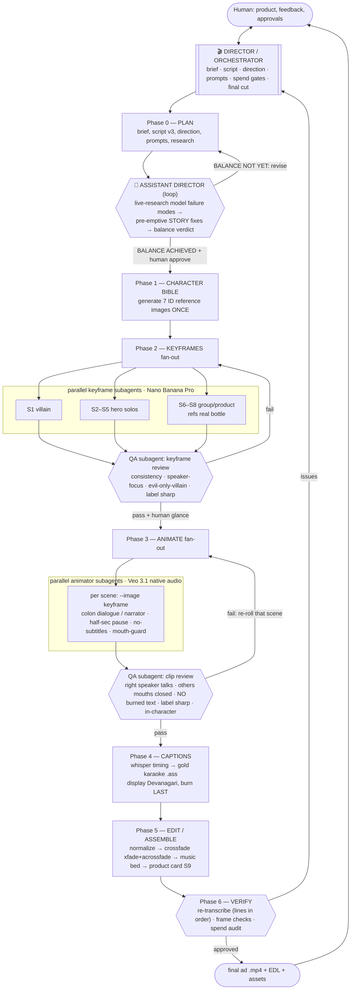

# Production workflow — orchestrator (Director) + subagents

How this ad gets made: I act as **Director/Orchestrator** (own the brief, decisions, spend gates, final cut); specialized **subagents** fan out the per-scene work in parallel. Human approval gates the expensive phases.

## Flow

## Roles & responsibilities
| Role | Owns | Does NOT |
|---|---|---|
| **Director / Orchestrator** (me) | brief, script, direction, prompt authorship, spend gates, scene routing, final assembly, verification, reporting | declare "done" on motion/voice it can't perceive — those need human eyes/ears |
| **Assistant Director** (`assistant-director` subagent) | pre-emptive risk audit of script+prompts vs the model's live-researched failure modes; ranked STORY-level fixes; loops with Director to `BALANCE ACHIEVED` (safety ↔ creativity) before any spend | generate video, spend credits, or edit the script (advises only) |
| **Keyframe subagent** | one scene's start keyframe from bible IDs (speaker-focused; bottle scenes ref real product) | animate or voice |
| **Animator subagent** | one scene: Veo 3.1 from the keyframe + the saved Veo prompt (native audio) | edit or assemble |
| **QA subagent** | adversarial review of keyframes/clips against the checklist; PASS/FAIL with evidence (frame-grabs) | fix — it reports; director re-routes |
| **Captioner** (director or subagent) | whisper-time each clip → gold karaoke `.ass` (Devanagari display) per `video-captions-karaoke` | change audio |
| **Editor** (director) | normalize → crossfade → music → burn captions LAST → product card → final verify | — |

## Phase gates (spend discipline)
- **Gate A (after Phase 0):** the **Assistant Director ↔ Director loop** must reach `BALANCE ACHIEVED`, then human approves script + direction — before any generation.
- **Gate B (after Phase 2):** keyframes reviewed (cheap, ~2 cr each) BEFORE animating (~22 cr each) — fix keyframes, not clips.
- **Gate C (pilot):** animate 1–2 scenes, human judges motion/voice/lip-sync, BEFORE batching all.
- **Gate D (after Phase 6):** human approves final cut; captions/music tweaks are cheap re-edits.

## QA checklists
**Keyframe:** character matches bible? · single clear speaker (dialogue scenes)? · group shots — heroes turned/profile, no lens-facing mouths? · heroes warm/good, only King evil? · S1 stomach faceless? · S7 bottle stylized to world? · no text in image?
**Clip:** correct character's mouth moves? · others' mouths closed / off-lens? · burned subtitles? · label sharp (S8) / forming-ok (S7)? · in-style, no morphing? · audio = right line, clean Hindi?

## AD research notes (carry into QA — 2026)
- **Burned text: EXPECT it, don't just hope the negative worked.** Veo's `no subtitles` negative is *necessary but weak* — Veo still burns garbled (often Devanagari) captions sometimes. QA must check every clip; remediation = crop/MarginV-cover or inpaint the burned strip, then re-roll only if unrecoverable. (Our gold karaoke layer goes on top regardless.)
- **Audio is experimental → can HARD-FAIL the generation, not just sound bad.** If a dialogue clip (S1–S5) fails to generate, retry; if it only fails *with* speech, debug the visual gen separately, then re-add the dialogue block. Budget a re-roll per dialogue shot.
- **Label text in I2V is unfixed in 3.1** — never rely on a motion clip for a legible label; S9 card is the only guaranteed-legible brand frame.

## Skills powering each phase
`caricature-talking-ad` (overall method + Phases 1-3,5) · `video-captions-karaoke` (Phase 4) · `higgsfield-cinematic` (model/prompt depth) · `multi-take-video-edit` (EDL/assembly patterns). Research: `research/prompting-guide.md`.
